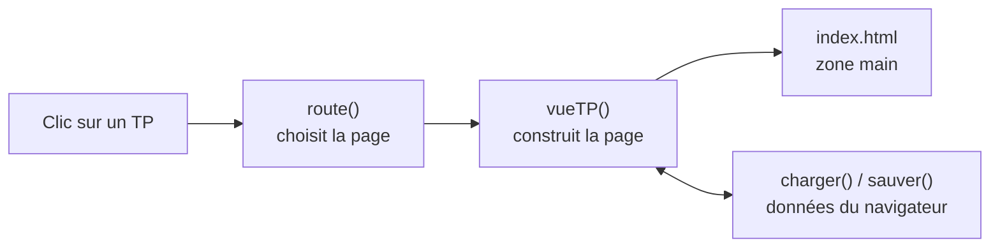

# Cielarte : carnet de TP

Site pour ranger tous mes TP du BTS : objectif, étapes, compétences, documents, questionnaires, commentaires et notes.

## Par où commencer ?

| Je veux… | J'ouvre… |
|---|---|
| Comprendre le projet rapidement | la section [Comprendre le projet en 5 minutes](#comprendre-le-projet-en-5-minutes) juste en dessous |
| Lancer le site sur mon PC | [Lancer le site](#lancer-le-site) |
| Modifier le site (page, apparence, logique) | [site/](site/README.md) |
| Ajouter les documents d'un nouveau TP | [site/documents-tp/](site/README.md#documents-des-tp) |
| Comprendre pourquoi c'est rangé comme ça | [docs/ARCHITECTURE.md](docs/ARCHITECTURE.md) |
| Trouver la définition d'un mot technique | [docs/GLOSSAIRE.md](docs/GLOSSAIRE.md) |
| Mettre le site en ligne | [docs/HEBERGEMENT.md](docs/HEBERGEMENT.md) |

## Comprendre le projet en 5 minutes

### Ce que fait le projet

Cielarte est un petit site web qui sert de carnet : pour chaque TP, on note ce qu'il fallait faire, les étapes suivies, les compétences travaillées et les documents fournis, et on peut se tester avec des questionnaires. Tout fonctionne dans le navigateur, sans serveur ni base de données à installer.

### La carte des dossiers

| Dossier | À quoi il sert, en langage courant |
|---|---|
| [site/](site/README.md) | Le site lui-même : tout ce que le navigateur affiche. C'est le seul dossier mis en ligne. |
| [site/css/](site/css/style.css) | L'apparence : couleurs, tailles, mise en page. |
| [site/js/](site/js/app.js) | Le comportement : ce qui se passe quand on clique, et l'enregistrement des données. |
| [site/documents-tp/](site/README.md#documents-des-tp) | Les fichiers fournis avec chaque TP (sujets, annexes, cours), un dossier par TP. |
| [docs/](docs/README.md) | Les explications pour comprendre et faire évoluer le projet. Ce dossier n'est pas mis en ligne. |
| `.github/workflows/` | La recette automatique qui met le site en ligne à chaque envoi sur GitHub. |

### Le trajet d'une action typique

Exemple : on clique sur un TP dans la liste « Mes TP ».

1. Le lien change l'adresse de la page en `#tp-…` (la partie après le `#` s'appelle le *hash*).
2. Dans `site/js/app.js`, la fonction `route()` voit ce changement et choisit la page à afficher : ici `vueTP()`.
3. `vueTP()` lit le TP dans les données chargées au démarrage par `charger()` (qui les prend dans le navigateur).
4. Elle construit la page et l'insère dans la zone `<main id="app">` de `site/index.html`. L'apparence vient de `site/css/style.css`.
5. Si on modifie quelque chose (cocher une étape, écrire une note), `sauver()` réenregistre tout dans le navigateur.



### Lancer le site

**Méthode rapide, sans rien installer :** ouvre le dossier `site/` et double-clique sur `index.html`. Le site s'ouvre dans ton navigateur. Seul l'aperçu des documents fournis avec les TP ne marche pas de cette façon (le navigateur bloque la lecture des fichiers locaux).

**Méthode complète, avec un petit serveur local** (nécessaire pour voir les documents des TP) :

1. Installe Python s'il n'est pas déjà là. Sous Windows, ouvre le Microsoft Store, cherche « Python 3 » et installe-le. Pour vérifier, tape dans un terminal :
   ```
   python --version
   ```
2. Récupère le dépôt, avec Git :
   ```
   git clone https://github.com/enzocerejo/Cielartes.git
   ```
   ou sur GitHub avec le bouton *Code → Download ZIP*, puis décompresse le fichier.
3. Va dans le dossier du site et lance le serveur :
   ```
   cd Cielartes/site
   python -m http.server 8000
   ```
4. Ouvre http://localhost:8000 dans ton navigateur. Pour arrêter le serveur, appuie sur `Ctrl + C` dans le terminal.

### Tester

Il n'y a pas de tests automatiques pour l'instant. Après une modification, lance le site (méthode complète) et vérifie à la main : la page d'accueil, la liste « Mes TP », la fiche du TP « Documenter le réseau d'un cabinet » avec l'aperçu d'un PDF, et l'export dans l'onglet *Données*. Pour vérifier qu'il n'y a pas d'erreur de syntaxe dans le JavaScript (avec [Node.js](https://nodejs.org) installé) :

```
node --check site/js/app.js
```

## Où sont mes données ?

Les TP, notes et fichiers que tu ajoutes sont enregistrés **dans le navigateur** (localStorage et IndexedDB), pas dans le dépôt. Ils restent sur ce PC et dans ce navigateur. Pour les garder ou les retrouver sur un autre PC : onglet **Données** → *Télécharger la sauvegarde*, puis *Importer* sur l'autre PC.

## Fonctionnalités

- **Mes TP** : liste avec recherche (titre, compétence, commande dans les notes…), filtre par matière et par statut, avancement.
- **Fiche TP** : présentation, étapes à cocher, documents avec aperçu et versions, questionnaires, commentaires, notes, bilan avec auto-évaluation.
- **Compétences** : toutes les compétences et les TP où elles ont été travaillées.
- **Données** : export et import JSON, réinitialisation.

## Règle de rangement

Chaque nouveau fichier va dans le dossier qui correspond à son utilité, jamais à la racine :

- ce que le navigateur charge va dans `site/` (documents d'un TP : `site/documents-tp/<nom-du-tp>/`) ;
- les explications sur le projet vont dans `docs/`.
