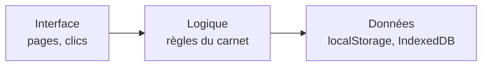

# Architecture

Pourquoi le dépôt et le code sont rangés comme ça. Chaque principe est d'abord expliqué simplement, puis nommé.

[← Retour à docs/](README.md)

## 1. Ce qui est publié est séparé de ce qui l'explique

Tout ce que le navigateur charge est dans `site/`, et rien d'autre. Les explications sont dans `docs/`, à côté. Comme ça, la mise en ligne n'a qu'un dossier à envoyer, et on ne publie jamais par erreur une note interne.

C'est ce qu'on appelle séparer **les sources publiées** de **la documentation du projet**.

```
Cielartes/
├── README.md                  porte d'entrée : par où commencer
├── .gitignore                 fichiers système à ne pas envoyer sur GitHub
├── .github/workflows/
│   └── pages.yml              mise en ligne automatique de site/
├── site/                      le site, et seulement le site
│   ├── index.html             point d'entrée
│   ├── css/style.css          apparence
│   ├── js/app.js              logique
│   ├── documents-tp/
│   │   └── documenter-reseau-cabinet/   fichiers fournis avec ce TP
│   ├── robots.txt, _headers   consignes aux moteurs de recherche
│   └── README.md
└── docs/                      explications (non publiées)
    ├── ARCHITECTURE.md, GLOSSAIRE.md, HEBERGEMENT.md
    └── README.md
```

## 2. Un seul point d'entrée

Le navigateur commence toujours par `site/index.html`. Ce fichier ne fait presque rien : il pose le cadre de la page et charge le CSS et le JavaScript. Tout le reste est délégué à `js/app.js`.

C'est ce qu'on appelle un **point d'entrée unique** : quand on cherche « où ça démarre ? », il n'y a qu'une réponse.

## 3. Chaque fichier a un rôle

- `index.html` dit **ce qu'il y a** sur la page (structure) ;
- `style.css` dit **à quoi ça ressemble** (apparence) ;
- `app.js` dit **ce que ça fait** (comportement).

On peut changer les couleurs sans risquer de casser la logique, et inversement. C'est ce qu'on appelle la **séparation des responsabilités**.

Les fichiers annexes sont rangés près de ce qui les utilise : les PDF d'un TP sont dans le dossier de ce TP (`documents-tp/<nom-du-tp>/`), pas dans un dossier « fichiers » commun.

## 4. Les trois couches de `app.js`, et le sens des dépendances

Dans `app.js`, le code se range en trois couches, de la plus visible à la plus profonde :

| Couche | Rôle | Exemples dans `app.js` |
|---|---|---|
| **Interface** | Afficher les pages et réagir aux clics | `route()`, `vueAccueil()`, `vueListe()`, `vueTP()`, les sections `sec…()`, `bandeau()` |
| **Logique** | Les règles du carnet : compléter les données, ajouter les TP fournis, mettre en forme le texte | `normaliser()`, `ajouterSeeds()`, `cheminDocument()`, `md()` |
| **Données** | Lire et écrire dans le navigateur | `charger()`, `sauver()` (localStorage), `blobDe()` et la base `cielarte-fichiers` (IndexedDB) |

Une page demande les données, mais le code qui enregistre les données ne sait rien des pages. Les flèches vont toujours dans le même sens :



C'est ce qu'on appelle des **dépendances à sens unique** (ou architecture en couches). L'intérêt : on pourrait remplacer le stockage dans le navigateur par une vraie base en ligne en ne touchant qu'à la couche Données.

## 5. Plan de `app.js`

Le fichier est découpé en parties, chacune annoncée par un commentaire `/* ---------- Nom ---------- */` :

| Partie | Ce qu'elle contient |
|---|---|
| Icônes | Les dessins SVG des icônes. |
| Données | TP d'exemple, TP fournis (`tpCabinet()`), chargement, normalisation, sauvegarde. |
| Outils | Petites fonctions partagées : sélecteurs, dates, Markdown, toast, fenêtres. |
| Bandeau | Salutation, menu, choix de palette et mode sombre. |
| Routeur | `route()`, qui choisit la page selon l'adresse. |
| Accueil, Liste des TP, Formulaire TP | Les pages correspondantes. |
| Page d'un TP | Le parcours d'un TP et ses sections (présentation, étapes, quiz, commentaires, notes, bilan). |
| Documents | Fichiers déposés (IndexedDB), versions et aperçus (PDF, Word, draw.io). |
| Compétences, Données | Les deux dernières pages. |

## 6. Limites connues et améliorations possibles

- **`app.js` est long** (environ 1 000 lignes, 12 parties). Il gagnerait à être découpé en un fichier par partie dans `site/js/` (par exemple `donnees.js`, `outils.js`, `routeur.js`, `pages/accueil.js`, `pages/tp.js`, `documents.js`). Il faudrait les charger avec plusieurs balises script classiques, et non des modules JavaScript, pour que le double-clic sur `index.html` continue de marcher.
- **Pas de tests automatiques.** Les fonctions de la couche Logique (`normaliser()`, `md()`) seraient les premières à tester.
- **Les données restent dans le navigateur.** Une base partagée entre plusieurs PC demandera un serveur (voir [HEBERGEMENT.md](HEBERGEMENT.md)).
